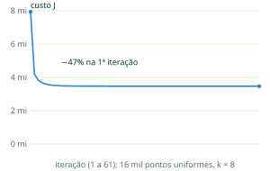
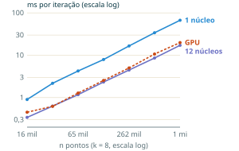
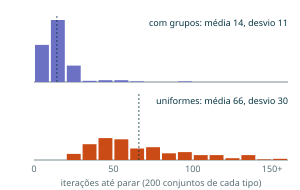
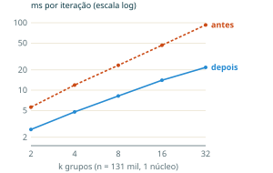

# K-means em Bend: custo por iteração, número de iterações e paralelismo

**João Vitor Sousa · Igor Targino**
FB UNI · Análise de Algoritmos · 2026

Versão em PDF: [`relatorio/relatorio.pdf`](relatorio/relatorio.pdf)

> **Reprodutibilidade.** `kmeans.bend` (algoritmo), `referencia.py` e `validar.py` (referência em Python e conferência), `medir.py` e `caso_medio.py` (medições), `relatorio/figuras.py` (figuras). Todas as medições num Apple M4 Pro (8 núcleos de desempenho e 4 de eficiência) com Bend 2.0.36; no 2.0.37 a conferência passa igual e os tempos variam menos de 5%. Como rodar: [no fim desta página](#como-rodar).

## Resumo

O k-means divide $n$ pontos em $k$ grupos repetindo dois passos: cada ponto vai para o centro mais próximo e cada centro vai para a média do seu grupo. Provamos que uma iteração custa $\Theta(nkd)$ para qualquer entrada, que o algoritmo sempre termina em no máximo $k^n$ iterações e que o melhor caso é uma única iteração; o pior caso pode exigir um número exponencial de iterações [3]. Como o caso médio não tem fórmula simples, medimos: em 400 conjuntos de dados, a média foi de 14 iterações para dados com grupos e 66 para dados uniformes. Implementamos o algoritmo em Bend, uma linguagem funcional que executa em paralelo na CPU e na GPU; os resultados coincidem com uma referência em Python, o tempo por iteração cresce linearmente em $n$ e em $k$, e 12 núcleos tornam cada iteração 3,9 vezes mais rápida.

## 1. Introdução

Agrupar dados parecidos sem rótulos prévios é um problema comum: segmentar clientes por perfil de compra, reduzir as cores de uma imagem ou agrupar textos a partir dos vetores gerados por modelos de linguagem. O k-means, na forma de Lloyd [1] e MacQueen [2], é a solução mais usada para isso.

A entrada é um conjunto $P$ de $n$ pontos em $\mathbb{R}^d$ e o número $k$ de grupos. A saída é um centro $c_j$ por grupo e o grupo de cada ponto. O objetivo implícito é diminuir o custo

$$J = \sum_{j=1}^{k} \sum_{x \in P_j} \lVert x - c_j \rVert^2,$$

a soma das distâncias ao quadrado de cada ponto ao centro do seu grupo.

Com milhões de pontos, duas perguntas importam: quanto custa cada iteração e quantas iterações são necessárias. Uma terceira é prática: quanto do trabalho pode ser dividido entre núcleos. Este relatório responde às três, com provas e medições.

## 2. O algoritmo

### 2.1 Pseudocódigo

O algoritmo de Lloyd, com o custo de cada linha em comentário ($I$ é o número de iterações):

```
K-MEANS(P, k)
  C ← k pontos de P           // Θ(k·d)
  repita                      // I vezes
    para cada p em P          // n vezes
      grupo[p] ← mais perto   // k × Θ(d)
    para cada grupo j         // somas Θ(n·d)
      C[j] ← média do grupo   // Θ(k·d)
  até C não mudar
  devolve C, grupo
```

### 2.2 Implementação em Bend

Em Bend, o paralelismo vem de uma única construção: `a b = f(x) g(y)` executa as duas chamadas ao mesmo tempo [8]. Por isso os pontos ficam numa árvore binária balanceada, e o passo 1 desce essa árvore dividindo o trabalho:

```python
def assign(+pts: Pts, +cs: List<&2, C>, +b: Nat) -> Sums:
  match pts:
    case PLeaf{+x, +y}:
      caminho(b, nearest(cs, x, y, 0, 0, 1.0e30), x, y)
    case PNode{l, r}:
      e d = assign(l, cs, b) assign(r, cs, b)
      juntar(e, d)
```

Em cada folha, `nearest` compara o ponto com os $k$ centros. As somas de cada grupo voltam pela árvore numa estrutura esparsa indexada pelo número do grupo: um ponto cria só o caminho até o seu grupo ($\log k$ nós), e `juntar` com um lado vazio não custa nada. O passo 2 divide cada soma pela quantidade de pontos. O laço para quando os centros se movem menos que $10^{-6}$ ao todo. A implementação usa $d = 2$ e números `F32`.

## 3. Operação básica

A operação mais repetida é a distância (ao quadrado) entre um ponto e um centro, $\sum_{i=1}^{d} (x_i - c_i)^2$: $d$ subtrações, $d$ multiplicações e $d - 1$ somas, ou seja, custo $\Theta(d)$. A raiz quadrada é dispensável, porque comparar distâncias ao quadrado dá a mesma ordem. Todas as demais operações (somar um ponto no seu grupo, dividir as somas) acontecem no máximo uma vez por ponto ou por grupo em cada iteração.

## 4. Análise

### 4.1 Custo de uma iteração

**Teorema 1.** *Para $n, k \geq 1$, uma iteração do k-means custa $\Theta(nkd)$, para qualquer entrada.*

*Prova.* O passo 1 calcula, para cada um dos $n$ pontos, a distância até cada um dos $k$ centros, ao custo $\Theta(d)$ cada: $c_1 nkd$ operações. O passo 2 soma cada ponto no seu grupo ($c_2 nd$) e divide $k$ somas ($c_3 kd$). Logo $T = c_1 nkd + c_2 nd + c_3 kd$. Como $nd \leq nkd$ e $kd \leq nkd$, vale $c_1 nkd \leq T \leq (c_1 + c_2 + c_3)\, nkd$, que é a definição de $\Theta(nkd)$. Nenhum termo depende dos valores dos pontos, então não há melhor nem pior caso dentro de uma iteração. ∎

O custo total é, portanto, $\Theta(I \cdot nkd)$, e toda a variação entre entradas está em $I$.

### 4.2 O algoritmo sempre termina

**Lema 1.** *Nenhum dos dois passos aumenta $J$.*

*Prova.* No passo 1, os centros estão fixos e cada ponto passa a usar o centro mais próximo, então a sua parcela em $J$ não aumenta. No passo 2, os grupos estão fixos. Para um grupo $P_j$ com média $\mu$ e qualquer ponto $c$, vale a identidade

$$\sum_{x \in P_j} \lVert x - c \rVert^2 = \sum_{x \in P_j} \lVert x - \mu \rVert^2 + |P_j| \cdot \lVert \mu - c \rVert^2,$$

porque o termo cruzado $2 \sum_x (x - \mu) \cdot (\mu - c)$ é zero. Então a média minimiza a soma, e trocar $c_j$ por $\mu$ não aumenta $J$. ∎

**Teorema 2.** *O k-means termina em no máximo $k^n$ iterações.*

*Prova.* Suponha que, em caso de empate, o ponto continue no grupo atual. Então, enquanto o algoritmo não para, o passo 1 move pelo menos um ponto para um centro estritamente mais próximo, e $J$ cai estritamente; pelo Lema 1, o passo 2 não o faz subir. Depois do passo 2, os centros são as médias dos grupos, então o valor de $J$ ao fim de cada iteração depende só do agrupamento. Como esse valor cai estritamente a cada iteração, nenhum agrupamento se repete. Existem no máximo $k^n$ formas de atribuir $n$ pontos a $k$ grupos, então há no máximo $k^n$ iterações. ∎

Nossa implementação desfaz empates escolhendo o centro de menor índice, e não o grupo atual; empates exatos de distância em `F32` não ocorreram nos testes. A Figura 1 mostra $J$ medido numa execução: ele cai em todas as 61 iterações, 47% logo na primeira.



*Figura 1. Custo $J$ por iteração numa execução com 16 mil pontos uniformes e $k = 8$, medido no programa em Bend.*

### 4.3 Melhor, pior e caso médio

**Melhor caso.** Se os centros iniciais já são as médias dos seus grupos, a primeira iteração não muda nada e o algoritmo para: $I = 1$ e custo $\Omega(nkd)$.

**Pior caso.** O Teorema 2 dá $O(k^n \cdot nkd)$. O limite não é só folga da prova: Vattani [3] construiu entradas no plano ($d = 2$) que exigem $2^{\Omega(n)}$ iterações.

**Caso médio.** Não há fórmula simples. Arthur, Manthey e Röglin [4] mostram que, com uma pequena perturbação aleatória nos dados, o número esperado de iterações é polinomial, o que explica por que na prática são poucas. Medimos esse comportamento na [Seção 5](#5-experimentos).

### 4.4 Trabalho e profundidade

Com o algoritmo em paralelo, interessa também a profundidade $D$: o tempo com núcleos ilimitados [7]. Numa iteração, o trabalho é $W = \Theta(nkd + n \log k)$: as distâncias mais a montagem das somas esparsas. A árvore de pontos tem altura $\log n$; cada folha faz $O(kd)$ e cada junção de somas custa no máximo $O(k)$, então $D = O(kd + k \log n)$. Pelo teorema de Brent [6], com $p$ núcleos o tempo é no máximo $W/p + D$. Para $n$ grande, $D$ é desprezível diante de $W/p$, e o ganho ideal seria próximo de $p$.

## 5. Experimentos

### 5.1 Validação

Uma referência em Python reproduz a mesma aritmética `F32` e a mesma ordem de somas. Em 10 configurações (variando $n$, $k$, tipo de dado e semente), o programa em Bend e a referência terminaram com o mesmo número de iterações, os mesmos centros (diferença máxima $4 \cdot 10^{-6}$) e o mesmo $J$ a cada iteração (diferença relativa abaixo de $10^{-7}$), e $J$ nunca aumentou.

### 5.2 Custo por iteração

Medimos o tempo de uma iteração rodando 10 e 20 iterações e dividindo a diferença por 10, o que exclui a geração dos pontos (melhor de 3 execuções). A Figura 2 mostra que o tempo cresce linearmente com $n$: a cada $4\times$ mais pontos, cerca de $4\times$ mais tempo. Com $n \approx 10^6$ e $k = 8$, são cerca de 8 ns por distância, já incluindo as somas.



*Figura 2. Tempo por iteração em função de $n$, com $k = 8$: 1 núcleo, 12 núcleos e GPU.*

| $n$ | 1 núcleo | 12 núcleos | GPU |
|:---|---:|---:|---:|
| 16 mil | 0,90 ms | 0,34 ms | 0,45 ms |
| 65 mil | 4,25 ms | 1,17 ms | 1,28 ms |
| 262 mil | 16,5 ms | 4,48 ms | 5,01 ms |
| 1 milhão | 67,1 ms | 17,2 ms | 19,9 ms |

*Tabela 1. Tempo por iteração, $k = 8$.*

### 5.3 Caso médio

Rodamos o algoritmo em 400 conjuntos de dados diferentes, com 16 mil pontos e $k = 8$: 200 com 8 grupos de verdade e 200 uniformes (Figura 3). Com grupos, a média foi de 14,4 iterações (desvio 11,1, de 2 a 91); uniformes, 66,1 (desvio 30,1, de 24 a 159). Nenhuma execução se aproximou do limite teórico: na prática o k-means é rápido, e mais rápido justamente quando os dados têm a estrutura que ele procura.



*Figura 3. Iterações até parar em 400 execuções ($n = 16\,384$, $k = 8$). Linha tracejada: média.*

### 5.4 Otimização

A primeira versão (`kmeans_v1.bend`) criava, em cada ponto, uma lista com as $k$ somas, quase toda de zeros, e juntava listas inteiras em cada nó: um custo extra de $\Theta(nk)$ em alocação. A versão com somas esparsas reduz esse custo para $\Theta(n \log k)$ sem mudar a operação básica. Com $n \approx 10^6$ e $k = 8$, o tempo por iteração caiu de 190 para 67 ms em 1 núcleo, de 55 para 17 ms em 12 núcleos e de 70 para 20 ms na GPU. A Figura 4 mostra o efeito ao variar $k$: antes o tempo dobrava a cada $k$ dobrado; depois segue $ank + bn \log k$, e o termo $nk$ ainda domina quando $k$ cresce.



*Figura 4. Tempo por iteração em função de $k$ ($n = 131\,072$, 1 núcleo), antes e depois das somas esparsas.*

### 5.5 Paralelismo

Com 12 núcleos, cada iteração ficou 3,9 vezes mais rápida e, na GPU, 3,4 vezes (Tabela 1). O ganho fica longe dos 12 que o teorema de Brent permitiria e para de crescer a partir de 8 núcleos. Um perfil de execução mostra o tempo concentrado na criação dos nós das somas, não nas distâncias, o que sugere que o limite é a alocação de memória; não verificamos essa hipótese além do perfil.

## 6. Conclusão

O custo de uma iteração do k-means é previsível, $\Theta(nkd)$, e os testes confirmaram o crescimento linear em $n$ e em $k$. O número de iterações não é: vai de 1 a $k^n$ em teoria, mas nas medições ficou em média entre 14 e 66, e o custo $J$ caiu em todas as iterações, como o Lema 1 garante. Em Bend, uma única linha de código distribui o passo 1 entre núcleos, e somas esparsas tornaram cada iteração três vezes mais rápida.

Duas extensões ficaram de fora: testar dimensões $d > 2$ (a análise vale para qualquer $d$, mas só medimos $d = 2$) e comparar a inicialização aleatória com a do k-means++ [5], que escolhe centros iniciais espalhados e costuma reduzir o número de iterações.

## Referências

1. Lloyd, S. P. Least squares quantization in PCM. *IEEE Transactions on Information Theory* 28, 2 (1982), 129–137.
2. MacQueen, J. Some methods for classification and analysis of multivariate observations. *Proceedings of the Fifth Berkeley Symposium on Mathematical Statistics and Probability* (1967), 281–297.
3. Vattani, A. k-means requires exponentially many iterations even in the plane. *Discrete & Computational Geometry* 45, 4 (2011), 596–616.
4. Arthur, D.; Manthey, B.; Röglin, H. Smoothed analysis of the k-means method. *Journal of the ACM* 58, 5 (2011).
5. Arthur, D.; Vassilvitskii, S. k-means++: the advantages of careful seeding. *Proceedings of the 18th Annual ACM-SIAM Symposium on Discrete Algorithms (SODA)* (2007), 1027–1035.
6. Brent, R. P. The parallel evaluation of general arithmetic expressions. *Journal of the ACM* 21, 2 (1974), 201–206.
7. Cormen, T. H.; Leiserson, C. E.; Rivest, R. L.; Stein, C. *Introduction to Algorithms*, 3ª ed. MIT Press, 2009.
8. Taelin, V. et al. BendRT: A Parallel Runtime for CPUs and GPUs. Higher Order Company, 2026. https://github.com/bendlang/bend/blob/main/paper/BendRT.pdf

---

## Como rodar

Requer [Bend](https://bend-lang.com) 2.0.36 ou mais novo, Python 3 e, para o PDF, [Typst](https://typst.app).

```sh
# compilar (no macOS, usar o cc da Apple) e assinar o binário
CC=/usr/bin/cc bend kmeans.bend -o kmeans && codesign -f -s - kmeans

# ./kmeans <log2 n> <k> <modo 0=grupos 1=uniforme> <max iteracoes> <semente> <historico 0|1>
./kmeans 14 8 1 200 15 1

python3 validar.py      # confere com a referência em Python
python3 medir.py        # tempo por iteração
python3 caso_medio.py   # 400 execuções

# relatório
cd relatorio && python3 figuras.py && typst compile relatorio.typ
```

| Arquivo | O quê |
|---|---|
| `kmeans.bend` | o algoritmo: pontos numa árvore, passo 1 em paralelo, somas esparsas por grupo |
| `kmeans_gpu.bend` | o mesmo, com o passo 1 na GPU |
| `kmeans_v1.bend` | primeira versão, antes da otimização das somas |
| `args.bend` | leitura dos argumentos da linha de comando |
| `referencia.py`, `validar.py` | referência em Python com a mesma aritmética e a conferência contra o Bend |
| `medir.py` | tempo por iteração variando $n$, $k$ e núcleos |
| `caso_medio.py` | 400 execuções para o caso médio e a curva do custo $J$ |
| `resultados*.csv`, `iteracoes.csv`, `custo_j.csv` | os dados medidos |
| `relatorio/` | o relatório em Typst, as referências e as figuras |
